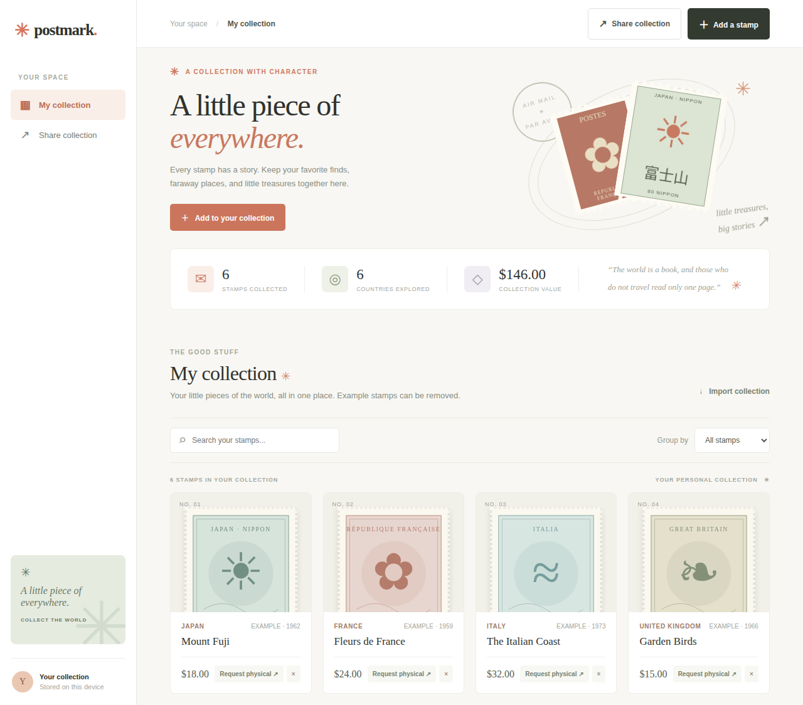
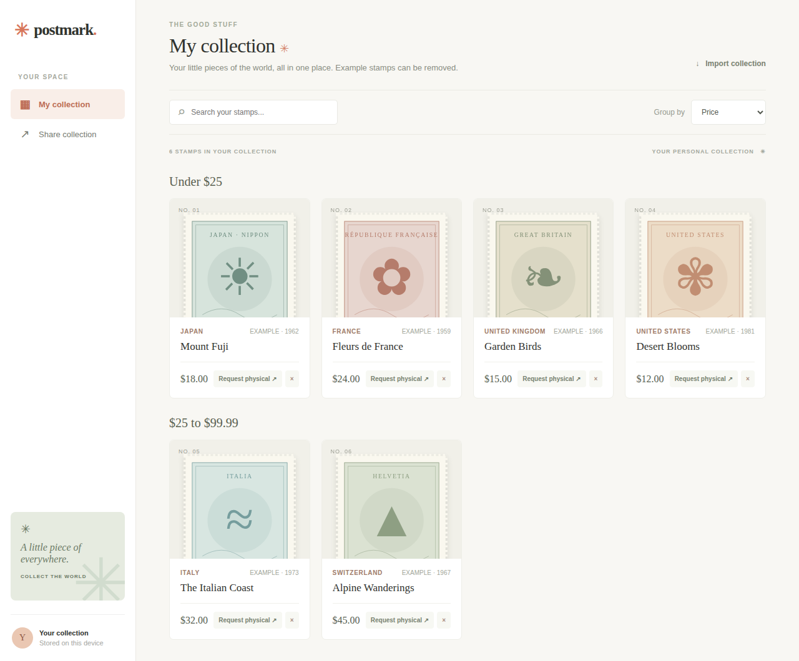
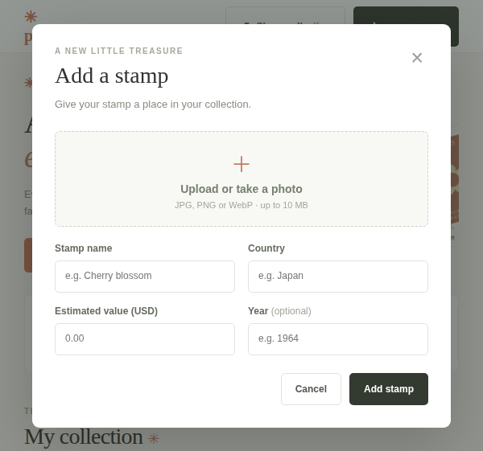
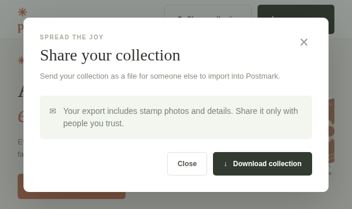
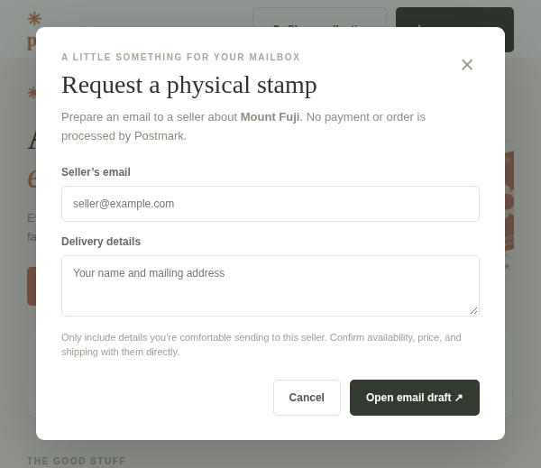
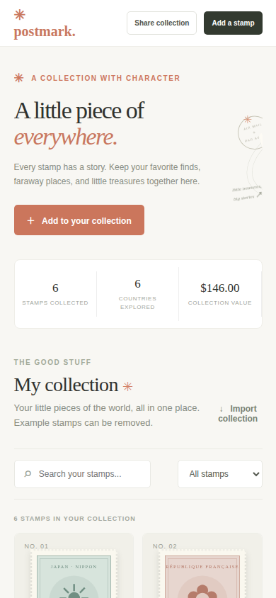

# Postmark

A small, browser-based digital stamp collection.

## Run locally

Run `npm start` (requires Python 3), then open <http://localhost:8000>.
No account, server-side storage, or installation of dependencies is required.

## Using your collection

- Add a stamp with a photo from your device or camera, a country, and an estimated
  value in US dollars. The initial collection contains removable examples.
- Search the collection or group it by country or price. Data is saved in this
  browser's local storage; clearing browser data or switching devices will remove
  access to it. Storage space depends on the browser.
- Share a collection by downloading its JSON file and sending it to someone you
  trust. They can import it into Postmark; importing replaces their current
  collection. The file includes photos and stamp details.
- Use **Request physical** to prepare an email to a seller of your choice with
  your delivery details. Postmark does not sell stamps, process payments, or
  arrange shipping; confirm those details directly with the seller.

## Screenshots

These screenshots show the built-in example stamps. They were captured in
Chromium on Linux, so fonts may look slightly different on your system.

### Grouped by price

### Add a stamp

### Share your collection

### Request a physical stamp

### Mobile layout

